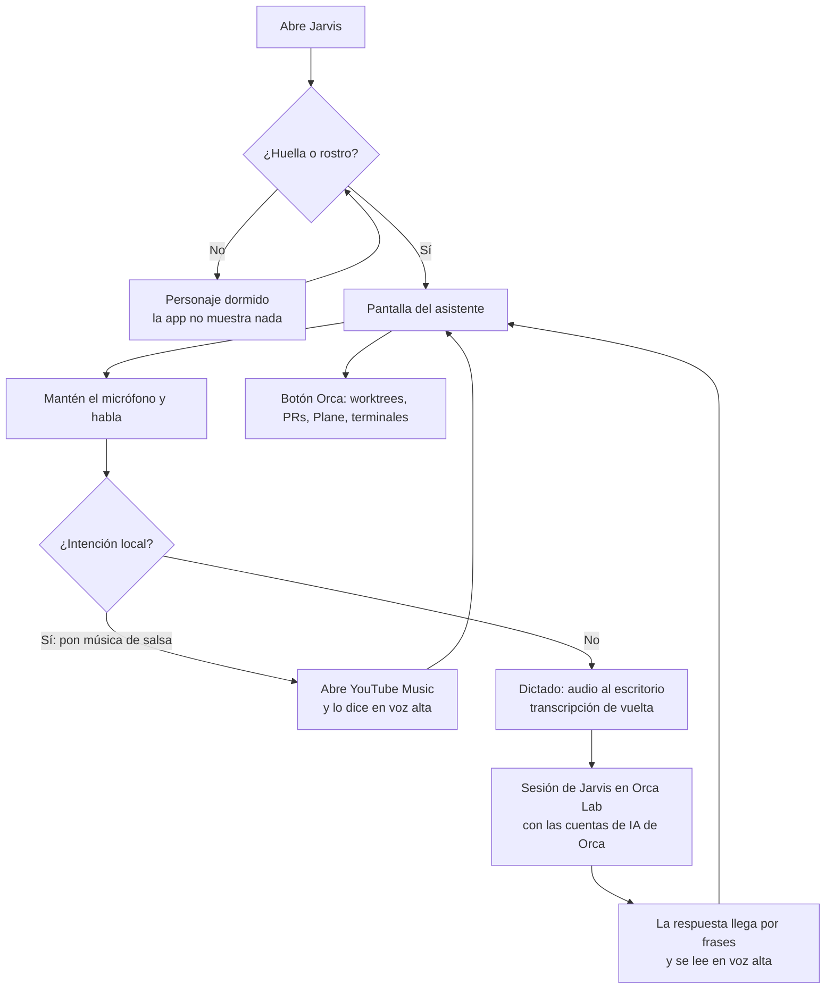

# PRD — Jarvis Mobile (APK Android)

> **Estado:** borrador de trabajo (MVP). Todo lo que el dueño no ha decidido está en §10 como
> decisión abierta, con dueño. No se inventó ningún dato de producto.

**Última actualización:** 2026-11-25

---

## 1. Qué es este producto

Jarvis Mobile es una aplicación Android de uso personal para Jhon Tamayo: un asistente de voz con
personaje propio que corre en el teléfono y razona con las cuentas de IA que ya administra Orca Lab.

Es un **fork de la app móvil de Orca Lab** (`ab2webco/orca-oss`, carpeta `mobile/`, MIT) al que se le
añaden cinco capacidades que el upstream no tiene:

1. **Personaje y UI de asistente**: un personaje animado (dos ojos dentro de un anillo) que reacciona
   a los estados de la conversación, con una pantalla de asistente propia.
2. **Bloqueo biométrico obligatorio**: pide huella o rostro al entrar y cada vez que la app vuelve a
   primer plano, aunque el teléfono ya esté desbloqueado.
3. **Voz de salida**: lee en voz alta las respuestas, por frases, mientras llegan.
4. **Intenciones locales**: órdenes que el teléfono resuelve sin consultar a la IA (por ejemplo
   reproducir música), para responder en menos de un segundo.
5. **Música de YouTube**: abre YouTube Music con la cuenta ya iniciada en el teléfono.

Por dentro sigue siendo Orca Lab: después del desbloqueo, worktrees, PRs, tablero de Plane y
terminales siguen disponibles desde la pantalla del asistente.

## 2. Por qué ahora

Hoy Jhon habla con Jarvis por WhatsApp. Ese canal sirve para texto, pero no le da lo que pidió en la
sesión del 2026-11-25:

- No puede dictar por voz ni escuchar la respuesta.
- Una respuesta que llega como texto obliga a leer; un plan le sirve más como audio.
- No puede pedir música.
- No quiere que cualquiera que tome su teléfono desbloqueado lea la conversación de su asistente.

La app móvil de Orca Lab ya resuelve la parte más costosa (conexión cifrada con el escritorio, chat
con agentes, dictado). Lo que falta es el producto alrededor, no la infraestructura.

## 3. Principio de arquitectura

**El teléfono es la cara y el oído; Orca Lab es el cerebro.**

Nada sensible vive en el teléfono y ninguna regla se escribe dos veces. La app captura voz, anima al
personaje, lee respuestas y ejecuta intenciones locales. Todo lo que requiere razonar, memoria o
herramientas lo hace una sesión de agente en el Orca Lab emparejado, con las cuentas de IA que Orca
ya administra. Las instrucciones del personaje viven en el escritorio, no en el repositorio.

## 4. Flujo principal

## 5. Requisitos funcionales

> Cada requisito trae su criterio de aceptación verificable. Lo que no se puede verificar no entra.

### Identidad y arranque

| ID | Requisito | Criterio de aceptación |
|---|---|---|
| RF-1.1 | La app se llama Jarvis, tiene ícono propio y convive con la app oficial de Orca Lab si ambas están instaladas. | Con ambas instaladas, el lanzador muestra dos apps con nombres y íconos distintos; ninguna reemplaza a la otra. |
| RF-1.2 | Al abrir en frío, después del desbloqueo se entra a la pantalla del asistente. | Arranque en frío: la primera pantalla tras el desbloqueo es la del asistente. |
| RF-1.3 | Volver del segundo plano después del desbloqueo devuelve a la pantalla donde estaba el usuario. | Con una pantalla de Orca abierta, ir al segundo plano, volver y desbloquear: sigue esa pantalla. |

### Bloqueo

| ID | Requisito | Criterio de aceptación |
|---|---|---|
| RF-2.1 | La app no muestra contenido mientras está bloqueada. | Al arrancar, antes de autenticar, solo se ve la pantalla de bloqueo. |
| RF-2.2 | Se pide autenticación biométrica al entrar y en cada regreso a primer plano, sin periodo de gracia. | Teléfono desbloqueado, app en segundo plano 1 segundo, volver: pide huella o rostro. |
| RF-2.3 | Si el usuario cancela el prompt, la app queda bloqueada y no vuelve a preguntar hasta que toque "Desbloquear" o regrese de nuevo. | Cancelar el prompt: no aparece otro prompt de forma automática. |
| RF-2.4 | Sin biometría inscrita se acepta el PIN o patrón del dispositivo. | Dispositivo sin huella y con PIN: el prompt ofrece el PIN y desbloquea. |
| RF-2.5 | Si el dispositivo no tiene ningún método de bloqueo, la app se queda cerrada y explica el motivo. | Dispositivo sin bloqueo de pantalla: mensaje claro, nunca entra. |

### Asistente

| ID | Requisito | Criterio de aceptación |
|---|---|---|
| RF-3.1 | Mantener presionado el micrófono dicta por voz y suelta el texto para enviarlo. | Mantener, hablar, soltar: el texto aparece en pantalla y se envía. |
| RF-3.2 | Se puede escribir con el teclado. | Escribir y enviar: el agente responde. |
| RF-3.3 | El personaje reacciona a cinco estados: reposo, escuchando, pensando, hablando, dormido. | Cada estado produce una animación distinta y reconocible. |
| RF-3.4 | La conversación ocurre con la sesión de Jarvis en el Orca Lab emparejado, usando las cuentas de IA de Orca. | Sin cambiar nada en el escritorio, la respuesta llega del agente de Orca con la cuenta seleccionada. |
| RF-3.5 | El usuario puede elegir qué espacio de trabajo de qué escritorio es "Jarvis". | En ajustes, elegir escritorio y espacio de trabajo; al volver a entrar, la sesión abre ahí. |
| RF-3.6 | Desde el asistente se llega a la interfaz completa de Orca Lab. | El botón Orca abre el inicio de Orca Lab. |

### Respuesta rápida y voz

| ID | Requisito | Criterio de aceptación |
|---|---|---|
| RF-4.1 | Las órdenes de música se resuelven en el teléfono, sin llamar a la IA. | "Ponme música de salsa": YouTube Music abre sin que la sesión de agente reciba nada. |
| RF-4.2 | La primera frase de una respuesta se empieza a leer antes de que la respuesta termine de llegar. | Respuesta de tres párrafos: la voz empieza con el primer párrafo completo, no al final. |
| RF-4.3 | Al leer en voz alta se omiten bloques de código, símbolos de formato y rutas de archivo. | Respuesta con un bloque de código: la voz no lee el código. |
| RF-4.4 | Las respuestas largas se recortan al hablar y la app avisa que el detalle está en pantalla. | Respuesta de más de ocho frases: la voz lee como máximo ocho y anuncia el recorte. |
| RF-4.5 | Leer en voz alta se puede apagar y encender. | Apagar: la siguiente respuesta no se lee. Encender: sí. |
| RF-4.6 | Tocar el personaje o un botón de detener interrumpe la lectura. | Mientras habla, tocar detener: se calla de inmediato. |
| RF-4.7 | Los planes se dictan como pasos cortos y numerados. | Pedir un plan: el audio dice los pasos en orden, cada uno en una frase. |

### Música

| ID | Requisito | Criterio de aceptación |
|---|---|---|
| RF-5.1 | "Pon / toca / reproduce X" abre YouTube Music con la cuenta del teléfono y reproduce X. | Decir la orden con YouTube Music instalado y sesión iniciada: suena X o abre su búsqueda. |
| RF-5.2 | Si YouTube Music no está instalado, se abre la búsqueda en el navegador. | Sin YouTube Music: se abre `music.youtube.com` con la búsqueda. |
| RF-5.3 | La app confirma en voz alta lo que va a reproducir. | Tras la orden, la voz dice qué va a sonar. |

## 6. Precondiciones técnicas

| Precondición | Estado | Nota |
|---|---|---|
| Orca Lab de escritorio con la app móvil habilitada (puerto 6768) | disponible | `fedora`, Orca Lab 1.4.160-lab.122. |
| Tailscale en el teléfono y en el escritorio | disponible | El teléfono `redmi-note-14-pro-5g` aparece en la tailnet. |
| Modelo de dictado descargado en el escritorio | disponible | `parakeet-tdt-0.6b-v3-int8` en el equipo local. |
| Espacio de trabajo de Jarvis en el escritorio, con las instrucciones del personaje | disponible | Lo crea este repositorio; ver `docs/personaje/jarvis.md`. |
| Cuenta de IA administrada por Orca | disponible | Dos cuentas registradas en el escritorio. |
| YouTube Music instalado y con sesión iniciada en el teléfono | pendiente de verificar en el teléfono | Lo confirma el dueño al probar. |
| GitHub Actions habilitado en el fork | disponible | Se habilitó en esta sesión. |
| Herramientas de construcción Android en los PCs de Windows y MacBook | no disponible | Ninguno tiene JDK ni SDK Android; el APK se construye en GitHub Actions. |

## 7. Fuera de alcance

Explícito para el MVP:

- iOS, publicación en tiendas y distribución a otras personas.
- Más de un usuario o más de un dueño.
- Pausar, saltar o bajar el volumen de la música (requiere código nativo de teclas multimedia).
- Palabra de activación sin tocar la pantalla ("oye Jarvis").
- Reproducción de música dentro de la propia app.
- Voz de nube con calidad de locución; el MVP usa la voz que trae el teléfono.
- Llamadas telefónicas, recordatorios del sistema o integración con el calendario.
- Cambios en la app de escritorio de Orca Lab. El fork solo modifica `mobile/`.

## 8. Fases

| Fase | Qué entrega | Criterio de cierre |
|---|---|---|
| F0 — Base | Fork, documentación, especificación, construcción del APK sin cambios en GitHub Actions. | Un APK del fork se construye y descarga desde Actions. |
| F1 — MVP | Personaje y pantalla del asistente, bloqueo biométrico, voz de salida, intenciones locales, música. | El dueño instala el APK en su teléfono y completa el flujo de §4 de principio a fin. |
| F2 — Controles | Pausar, saltar y volumen; lista de reproducción favorita; palabra de activación. | Por definir después de probar F1. |
| F3 — Voz de calidad | Voz de nube y personalización del timbre. | Por definir después de probar F1. |

## 9. Métricas de éxito

Medidas sobre el teléfono del dueño, durante la primera semana de uso:

| Métrica | Meta |
|---|---|
| Tiempo desde soltar el micrófono hasta que suena la confirmación de una orden de música | Menos de 1 segundo. |
| Tiempo desde terminar de hablar hasta escuchar la primera frase de la respuesta | Menos de 8 segundos. |
| Veces que se pide el desbloqueo sin que la app haya ido a segundo plano | 0. |
| Instalación y emparejamiento en el primer intento | Sí. |

## 10. Decisiones abiertas

| Pregunta | Quién decide | Desde | Qué bloquea |
|---|---|---|---|
| ¿Jarvis se mantiene como app separada o se vuelve un modo de la app de Orca Lab? | Jhon Tamayo | 2026-11-25 | Nada; el MVP avanza como app separada (ADR-001). |
| ¿Qué cuenta de IA usa Jarvis por defecto: la suscripción de Claude o el endpoint de z.ai? | Jhon Tamayo | 2026-11-25 | Nada en el MVP; se usa la cuenta seleccionada en el escritorio. |
| ¿Se quiere un periodo de gracia corto (por ejemplo 15 segundos) al volver del segundo plano? | Jhon Tamayo | 2026-11-25 | Nada; el MVP no tiene gracia, como se pidió. |
| ¿Se bloquean las capturas de pantalla y la vista previa de apps recientes? | Jhon Tamayo | 2026-11-25 | Una línea de código nativo; hoy la vista previa de apps recientes puede mostrar lo último que se vio. |
| ¿El timbre de voz del personaje es la voz del sistema o una voz de nube? | Jhon Tamayo | 2026-11-25 | Fase F3. |
| ¿Se ofrece el bloqueo de app como mejora al upstream de Orca Lab? | Jhon Tamayo | 2026-11-25 | Nada. |
| ¿YouTube Music está instalado y con sesión en el teléfono? | Jhon Tamayo | 2026-11-25 | Prueba de RF-5.1 en el teléfono. |
| ¿Cuánta autonomía tiene Jarvis en el escritorio: pide permiso por cada herramienta o trabaja con un modo de confianza? | Jhon Tamayo | 2026-11-26 | Nada en el MVP. Hoy cada permiso se aprueba en Orca Lab y el teléfono solo avisa. |
| ¿Se mantiene la confirmación extra (el botón "Confirmar") después de leer la huella? | Jhon Tamayo | 2026-11-26 | Nada; es una línea. Sin ella, la huella sola alcanza para entrar. |

## 11. Limitaciones conocidas del MVP

Se saben y se aceptan para esta versión; cada una dice cuándo se corrige.

| Limitación | Afecta a | Qué pasa | Cuándo se corrige |
|---|---|---|---|
| La app no distingue YouTube Music de un navegador. | RF-5.2 | Sin YouTube Music instalado, anuncia la orden y no abre nada. | F2: apuntar la orden al paquete de YouTube Music. |
| Nada se probó en un teléfono antes de entregar. | RF-3, RF-4, RF-5 | Los equipos del proyecto no tienen SDK Android; la lógica está probada con pruebas unitarias. | F4: el dueño valida en su teléfono con `docs/instalacion-y-prueba.md`. |
| Las pantallas de Orca Lab siguen en inglés y con su marca. | RF-3.6 | Solo la pantalla del asistente, sus ajustes y el bloqueo están en español y con la identidad de Jarvis. | Por decidir después de probar. |
| La vista previa de "apps recientes" puede mostrar lo último que se vio. | RF-2.1 | La app bloquea el contenido, pero Android guarda una imagen estática al mandarla al segundo plano. | Decisión abierta en §10. |
| En Android, cada diálogo del sistema bloquea la app. | RF-2.2 | Android no distingue perder el foco de irse a segundo plano: el diálogo de un permiso (el del micrófono, la primera vez), el selector de fotos o la hoja de compartir cuentan como irse, y Jarvis pide la huella al volver. A cambio, ninguna salida deja el candado abierto. | F2: distinguir en código nativo las salidas que la propia app inicia. |
| Al emparejar desde Jarvis, la app lleva al inicio de Orca Lab. | RF-3.4 | Las pantallas de emparejamiento son las de Orca Lab y terminan allá. Con Atrás se vuelve a Jarvis, que ya tiene el escritorio. | F2: volver directo al asistente. |
| Jarvis no aprueba permisos de Claude desde el teléfono. | RF-3.4 | Cuando Claude pide permiso para una herramienta, Jarvis avisa «Espero tu permiso en Orca Lab» y no envía nada hasta que se apruebe en el escritorio. | Decisión abierta en §10: cuánta autonomía tiene Jarvis. |
| La confirmación de música retrasa la música unos dos segundos. | RF-5.3 | Al abrir YouTube Music la app pasa a segundo plano y se calla. Por eso dice la confirmación completa primero y abre después. Con la voz apagada abre de inmediato. | Por decidir después de probar. |
| Si una respuesta llega en un solo bloque, la voz espera a que termine. | RF-4.2 | La voz lee lo que Claude ya escribió en su historial. Si lo escribe todo de una vez, no hay frase temprana. | F2: leer del flujo en vivo. |
| Mientras habla, la línea de estado muestra la última frase encolada, no la que está sonando. | RF-4.6 | Cosmético: el texto va unos instantes adelantado a la voz. | F2. |
