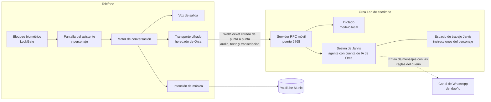
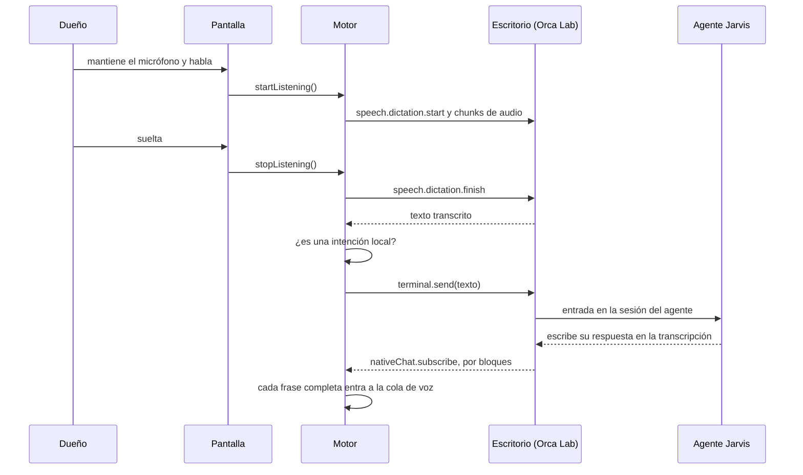
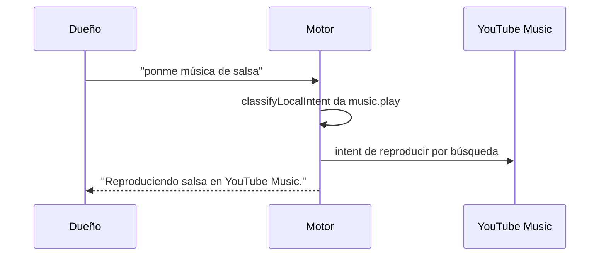
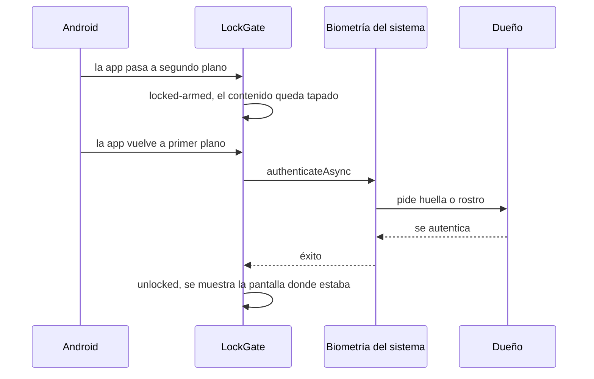

# Arquitectura — Jarvis Mobile

**Última actualización:** 2026-11-25

> Este documento se actualiza en el mismo PR que mueve un límite del sistema. No después.
> Las rutas con prefijo `mobile/` o `src/` son relativas a la raíz del repositorio.

---

## 1. Principio rector

**El teléfono es la cara y el oído; Orca Lab es el cerebro.**

Tres consecuencias que ordenan todas las demás:

1. **Nada sensible vive en el teléfono.** El teléfono guarda lo mismo que guarda la app de Orca
   Lab: el token de emparejamiento, en el almacén seguro del dispositivo.
2. **Ninguna regla se escribe dos veces.** Lo que requiere razonar, memoria o herramientas lo hace
   una sesión de agente en el escritorio. En el teléfono solo vive lo que debe responder en menos de
   un segundo.
3. **El repositorio es público, así que no guarda nada íntimo.** El personaje y sus instrucciones se
   instalan en el escritorio; el repositorio trae la fuente y el instalador.

## 2. Contexto



### Límites de confianza

| # | Zona | Qué se asume de ella | Cómo se hace cumplir |
|---|---|---|---|
| 1 | Teléfono desbloqueado | Solo el dueño pasa la biometría. | `LockGate`: nada se muestra sin autenticar (RF-2). |
| 2 | Red entre teléfono y escritorio | Cualquiera en la misma red o en la tailnet puede alcanzar el puerto. | Cifrado de punta a punta con clave del escritorio fijada al emparejar; token de dispositivo en el almacén seguro. |
| 3 | Escritorio con Orca Lab | Es el equipo del dueño y ejecuta lo que la sesión de agente decida. | Es el límite de mayor confianza; la sesión hereda los permisos del agente y del usuario del sistema. |
| 4 | YouTube Music | App de terceros con la cuenta del dueño. | Solo recibe el texto de la búsqueda, codificado como URL. Nunca recibe datos de la conversación. |

## 3. Flujos principales

### 3.1 Hablar con Jarvis



El dictado y el chat nativo no se reescriben: son los de la app de Orca Lab
(`mobile/src/hooks/use-mobile-dictation.ts`, `mobile/src/session/use-mobile-native-chat-session.ts`).
El motor de Jarvis los coordina y añade dos pasos: la intención local antes de enviar y la voz de
salida al recibir.

### 3.2 Orden de música



Nada de este flujo toca la red. Por eso responde en menos de un segundo.

### 3.3 Bloqueo y desbloqueo



La tabla de transiciones está en `mobile/src/jarvis/lock-policy.ts` y sus porqués en el encargo
`docs/agentes/encargo-bloqueo-macbook.md`.

## 4. Stack y versiones

Lo hereda todo del upstream (`mobile/package.json`). El fork solo añade lo de la última fila.

| Pieza | Versión | Por qué esa |
|---|---|---|
| React Native | `^0.83.9` | La que fija Expo SDK 55. No se sube aparte. |
| Expo | `^55.0.27` | La del upstream; subir el SDK es un cambio de plataforma. |
| React | `^19.2.6` | La que exige Expo 55. |
| TypeScript | `6.0.3` | La del upstream. |
| Vitest | `4.1.11` | La del upstream; dos proyectos, `node` y `render`. |
| oxlint / oxfmt | `^1.71.0` / `^0.52.0` | Lint y formato del upstream, con límite de líneas por archivo. |
| pnpm | `10.24.0` | `packageManager` de la raíz; el lockfile es estricto (`--frozen-lockfile`). |
| Node | 24 | `engines.node` de la raíz. |
| JDK | 17 | Lo instala el workflow de Android. |
| `expo-speech` | la de SDK 55 | **Único módulo nuevo del fork.** Voz de salida en el dispositivo; ver ADR-003. |
| `expo-font` | la de SDK 55 | Declaración directa de un módulo que ya venía compilado. Solo habilita su plugin de configuración para la tipografía del personaje; ver ADR-008. |

## 5. Estructura de carpetas

Lo nuevo del fork vive en tres sitios. El resto del repo es upstream y se sincroniza con
`git merge upstream/main`.

```
mobile/
├── app/
│   ├── jarvis.tsx            Pantalla del asistente. Solo ata el motor con la pantalla.
│   ├── jarvis-settings.tsx   Ajustes de Jarvis: espacio de trabajo y voz.
│   ├── _layout.tsx           (editado) registra las dos pantallas y envuelve la navegación en LockGate.
│   ├── index.tsx             (editado) en arranque en frío redirige a /jarvis una sola vez.
│   └── app.json              (editado) identidad Jarvis, tipografía y plugin del manifiesto.
├── assets/
│   ├── jarvis/               Ícono, ícono adaptativo y de arranque, con su fuente SVG.
│   └── fonts/                Chakra Petch SemiBold y su licencia.
├── src/jarvis/               Todo lo propio del fork. Nada fuera de aquí importa adentro, salvo app/.
│   ├── jarvis-contract.ts    Tipos del contrato pantalla ↔ motor. Sin código ejecutable.
│   ├── jarvis-theme.ts       Paleta y tipografía del personaje.
│   ├── jarvis-entry.ts       A dónde aterriza el arranque en frío. Puro.
│   ├── character/            El personaje animado: anillo, ojos, movimiento y mirada.
│   ├── jarvis-home/          Las partes de la pantalla: escenario, conversación, micrófono,
│   │                         acciones rápidas, avisos y ajustes.
│   ├── jarvis-markdown.ts    Markdown a texto plano para la conversación en pantalla.
│   ├── use-jarvis-conversation.ts   Motor: coordina dictado, sesión, intenciones y voz.
│   ├── use-jarvis-session-attach.ts, jarvis-session-attacher.ts, jarvis-session-attach.ts
│   │                         Encuentran o abren la pestaña de Claude del espacio de trabajo.
│   ├── use-jarvis-transcript.ts, jarvis-transcript-merge.ts
│   │                         La conversación: historial, eco de lo enviado, respuesta en vivo.
│   ├── use-jarvis-outbox.ts  Envía al agente y espera a que lo tome.
│   ├── use-jarvis-reply-voice.ts, use-jarvis-speech.ts, jarvis-speech-queue.ts, jarvis-speech-tracker.ts
│   │                         Voz de salida: qué leer, en orden, sin repetir.
│   ├── speech-markdown.ts, speech-sentences.ts, speech-text.ts
│   │                         Markdown a frases que se pueden leer. Puros.
│   ├── conversation-activity.ts, jarvis-dictation-status.ts
│   │                         Estado del personaje y texto de la línea de estado. Puros.
│   ├── local-intents.ts      Clasificador de intenciones. Puro.
│   ├── local-intent-handler.ts, default-local-intent-handler.ts, youtube-music.ts
│   │                         Resolución de la orden de música en el teléfono.
│   ├── jarvis-preferences.ts, jarvis-preferences-store.ts, use-jarvis-preferences.ts
│   │                         Espacio de trabajo elegido y voz activada.
│   ├── use-jarvis-host-worktrees.ts, use-jarvis-workspace-options.ts
│   │                         Catálogo de escritorios y espacios de trabajo.
│   ├── use-jarvis-dictation-availability.ts   Si el escritorio puede dictar.
│   ├── lock-policy.ts        Máquina de estados del bloqueo. Puro.
│   ├── use-app-lock.ts       La conecta con AppState y la biometría.
│   ├── LockGate.tsx          El candado de la app. Publica su estado con use-lock-state.ts.
│   ├── use-lock-state.ts     El estado del candado, para que el motor se calle con la app bloqueada.
│   ├── jarvis-root-gate.test.ts, jarvis-app-config.test.ts, jarvis-dependency-boundaries.test.ts
│   │                         Límites: el candado cubre toda la app, la configuración y las reglas de abajo.
│   └── *.test.ts             Junto a cada archivo, como pide el upstream.
├── plugins/
│   └── jarvis-android-manifest.js   Declara <queries> para ver YouTube Music.
└── scripts/
    └── generate-jarvis-icons.mjs    Redibuja los íconos desde la geometría del personaje.
mobile/src/transport/pairing.ts (editado)   Acepta enlaces jarvis:// además de orca://.
docs/                        Documentación del fork (ver GOBERNANZA.md).
scripts/
├── spec-gate.mjs             Puerta de especificación.
└── jarvis/install-workspace.sh   Instala el personaje en el escritorio.
personaje/jarvis-mobile/      Las instrucciones del personaje que se instalan en el escritorio.
openspec/changes/<cambio>/    Especificación, diseño y tareas de cada cambio.
```

### Reglas de dependencia

Se verifican con una prueba (`mobile/src/jarvis/jarvis-dependency-boundaries.test.ts`), no con
buena voluntad:

1. `app/jarvis.tsx` y `app/jarvis-settings.tsx` importan de `jarvis-contract.ts`, `character/`,
   `jarvis-theme.ts`, los hooks del motor, `jarvis-home/` y `default-local-intent-handler.ts`. Nunca
   de `src/transport`, `src/session` ni `src/hooks`.
2. `character/` no importa nada del motor ni del transporte. Solo recibe un estado y lo anima.
3. Los archivos puros (`speech-*.ts`, `local-intents.ts`, `lock-policy.ts`, `conversation-activity.ts`,
   `jarvis-transcript-merge.ts`, `jarvis-speech-tracker.ts`, `jarvis-session-attach.ts`,
   `local-intent-handler.ts`, `jarvis-dictation-status.ts`) no importan React ni React Native, y se
   prueban sin simulaciones.
4. Nada de `src/jarvis/` modifica archivos del upstream. El fork edita solo estos: `app/_layout.tsx`,
   `app/index.tsx`, `app.json`, `package.json`, `pnpm-lock.yaml`, `src/transport/pairing.ts` con su
   prueba y `src/store-release-identity.test.ts`. La misma prueba falla si aparece otro.

### Voz, candado y lo que pasa antes de desbloquear

El candado deja las pantallas montadas mientras la app está bloqueada (RF-1.3), así que el motor
sigue corriendo detrás de la tapa. La tapa es un `Modal` nativo y no una vista encima: los paneles
desplegables de Orca Lab son ventanas nativas propias, y una vista no puede cubrirlos.

En Android el estado `inactive` no existe. Cualquier pantalla ajena (el diálogo de un permiso, el
selector de fotos, YouTube Music) llega como `background` y bloquea la app. Es un costo asumido: a
cambio ninguna salida deja el candado abierto. Por eso `LockGate` publica su estado
(`use-lock-state.ts`) y `use-jarvis-conversation`, con la app bloqueada:

- no lee en voz alta: al bloquear se calla, y el saludo y las respuestas que lleguen bloqueadas no
  se leen;
- no dicta ni abre el micrófono: el permiso del micrófono, la primera vez, bloquearía la app con la
  grabación a punto de abrirse;
- no crea una sesión de Claude en el escritorio. Una que ya existe sí la encuentra.

Tres reglas más del motor, que nacieron de la revisión antes del primer APK:

- Mantener el micrófono corta la lectura y deja mudo el resto de ese turno. El dictado oye por el
  micrófono del teléfono y tomaría la voz del propio Jarvis.
- La confirmación de una orden de música se dice antes de abrir YouTube Music, porque al abrirse
  la app pasa a segundo plano y se calla. La orden recibe la voz del motor (`JarvisOrderVoice`).
- Cuando Claude pide un permiso en el escritorio, la línea de estado lo dice y no se envía nada:
  un mensaje tecleado en ese diálogo lo respondería.

## 6. Seguridad: precondiciones heredadas

Lo que este proyecto asume del upstream. Cada supuesto con su evidencia.

| Supuesto | Estado | Evidencia |
|---|---|---|
| El token de dispositivo se guarda cifrado por el sistema operativo y se pierde al reiniciar el teléfono hasta el primer desbloqueo. | verificado | `mobile/src/transport/host-device-token-store.ts:10,21-35` (`WHEN_UNLOCKED_THIS_DEVICE_ONLY`) |
| Todo el tráfico con el escritorio se cifra con una clave efímera y la clave pública del escritorio fijada al emparejar. | verificado | `mobile/src/transport/rpc-client.ts:358-432`, `mobile/src/transport/e2ee.ts:76-101` |
| El servidor del escritorio, una vez emparejado, escucha en todas las interfaces y no filtra por IP de origen. | verificado | `src/main/runtime/runtime-rpc.ts:1588-1592` |
| Los tokens de dispositivo del lado del escritorio están en un archivo JSON sin cifrar. Solo los protegen los permisos restringidos con los que se escribe ese archivo. | verificado | `src/main/runtime/device-registry.ts:60,81`, `src/shared/secure-file.ts:91-93` |
| El teléfono solo puede llamar a los métodos RPC incluidos en la lista permitida para móviles. | verificado | `src/main/runtime/runtime-rpc.ts:200-515` |
| El socket va sin TLS (WebSocket plano). | verificado | `mobile/app.json`, `usesCleartextTraffic: true` |

Los dos supuestos de red son el riesgo principal heredado: el puerto del escritorio queda expuesto
a quien alcance la red. Este proyecto no hace modelado de amenazas (decisión del dueño del
2026-11-25, registrada en `GOBERNANZA.md`): esta tabla es la lista de riesgos heredados que se
aceptan. La mitigación operativa del MVP es usar la tailnet y no la red local abierta.

## 7. Decisiones registradas

Las decisiones con alternativas descartadas viven en `docs/03-decisiones/`. Este documento describe
el estado; los ADR explican cómo se llegó a él.

| ADR | Decisión |
|---|---|
| [ADR-001](03-decisiones/ADR-001-app-separada-desde-un-fork.md) | App separada, construida desde un fork del monorepo. |
| [ADR-002](03-decisiones/ADR-002-el-cerebro-vive-en-orca-lab.md) | El razonamiento ocurre en una sesión de agente del Orca Lab emparejado. |
| [ADR-003](03-decisiones/ADR-003-voz-de-salida-en-el-dispositivo.md) | Voz de salida con `expo-speech`, por frases, en el teléfono. |
| [ADR-004](03-decisiones/ADR-004-musica-por-intencion-a-youtube-music.md) | La música se abre en YouTube Music con la cuenta del teléfono. |
| [ADR-005](03-decisiones/ADR-005-bloqueo-biometrico-sin-gracia.md) | Bloqueo biométrico en cada regreso a primer plano, sin gracia. |
| [ADR-006](03-decisiones/ADR-006-apk-por-github-actions.md) | El APK se construye en GitHub Actions. |
| [ADR-007](03-decisiones/ADR-007-personaje-en-el-escritorio-no-en-el-repo.md) | El personaje se instala en el escritorio; el repositorio es público. |
| [ADR-008](03-decisiones/ADR-008-identidad-visual-del-personaje.md) | Identidad visual: dos ojos en un anillo, ámbar sobre azul profundo. |
